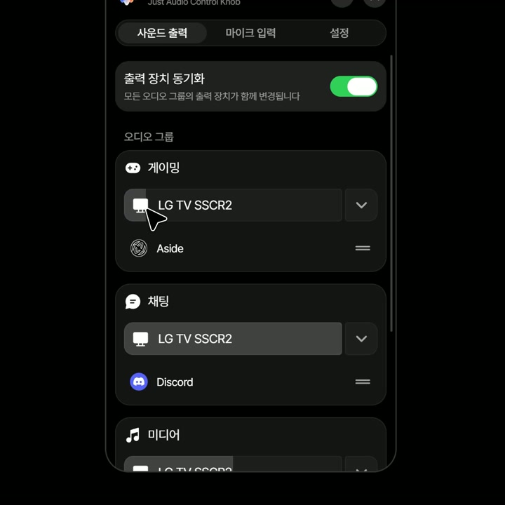

# Jack

[▶ Jack 데모 영상 재생](https://github.com/mightyidler/Jack/blob/main/Jack_demo.mp4)

Windows 11용 오디오 제어 앱입니다. SteelSeries GG의 Sonar Classic에 연결하여 그룹별 볼륨·출력 장치·앱 배정과 마이크를 제어합니다.

## 설치

1. [Releases](https://github.com/mightyidler/Jack/releases)에서 설치 파일을 받습니다.
2. GG가 없으면 안내에 동의한 뒤 공식 최신 GG를 설치합니다. 이미 설치되어 있으면 기존 설치를 사용하며, 구버전은 동의 후 업데이트할 수 있습니다.
3. GG에서 Sonar를 켜고 Classic 모드와 실제 출력 장치·마이크를 설정합니다. Jack의 연결 안내에서 다시 시도할 수 있습니다.

GG 설치를 거절하면 Jack 신규 설치가 중단됩니다. 인터넷 연결과 GG 설치 시 관리자 승인이 필요할 수 있습니다. GG가 요청하면 재부팅 후 설정을 이어가세요. GG 설치 파일과 드라이버는 Jack에 포함하지 않습니다.

## 업데이트·복구

Jack은 앱 시작 시 한 번 업데이트를 확인하고, 새 버전이 있으면 서명을 검증한 뒤 바로 설치·재시작합니다. 트레이로 시작할 때도 동작하며 별도의 끄기 설정이나 주기적 확인은 없습니다. 확인·다운로드에 실패하면 현재 버전을 계속 사용하며 다음 앱 시작 시 다시 확인합니다. 설정에서 수동 확인도 가능합니다. Jack과 GG의 업데이트는 별개입니다. 기존 GG 설정은 Jack이 초기화하지 않습니다.

Windows 시작 실행은 기본 ON이며 설정에서 끌 수 있습니다.

연결이 끊기면 다시 시도를 누르세요. 설치된 GG가 꺼져 있으면 실행한 뒤 다시 연결합니다. Sonar 활성화·Classic 모드는 GG에서 확인해 주세요. GG 최신 버전을 확인하지 못하면 최신으로 표시하지 않습니다. Jack 제거 시 GG와 Jack 사용자 설정은 유지합니다.

## 제한·라이선스

Sonar의 비공식 로컬 API를 사용하므로 GG 업데이트에 따라 연동이 중단될 수 있습니다. Streamer 모드, EQ, ChatMix는 지원하지 않습니다. 실제 재생·녹음과 장치 호환성은 사용 환경에서 확인해 주세요.

Jack은 SteelSeries의 공식 제품이 아니며, 제휴·보증을 의미하지 않습니다. GG에는 제공자의 별도 약관이 적용됩니다.

소스는 [GPL-3.0](LICENSE)으로 제공합니다. 외부 코드·폰트·아이콘은 [고지](THIRD_PARTY_NOTICES.md)를 참고하세요. [개발](docs/development.md) · [배포 확인 항목](docs/distribution-checklist.md)
